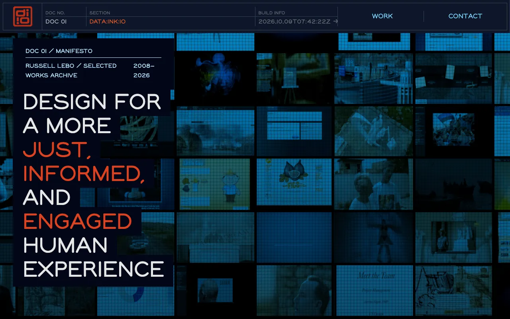
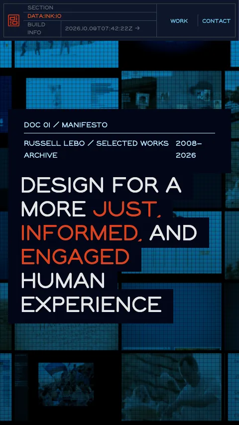
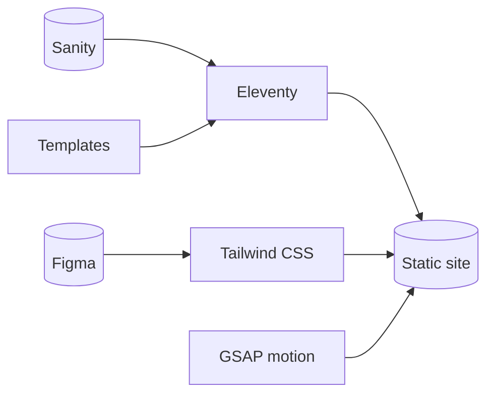

# dataink.io

[](package.json)
[](package.json)
[](package.json)
[](styles/colors.css)
[](package.json)
[](package.json)
[](LICENSE)

The source for [dataink.io](https://dataink.io), the portfolio of Russ Lebo, a designer who builds.

It was that time of career again. The stale one-pager had to go. The new site gets its content from Sanity and its colours and fonts from Figma. Eleventy turns all of that into plain HTML, and GSAP adds the motion on top.

<p>
  
  
</p>

## How it works



- **Plain HTML first.** Eleventy builds every page ahead of time, so the site works before any JavaScript loads.
- **Design and code stay in sync.** Colours and fonts are generated from the Figma file, not copied by hand.
- **Content is structured.** It comes from Sanity at build time. Nothing calls the CMS while you browse.
- **Motion respects you.** Each screen size gets its own motion, and if you've turned on reduced motion, scroll animation is off everywhere.

## Run it

Needs Node 18 or later. No accounts or keys required.

```bash
npm install
npm start       # local dev server
```

Without a `.env` file, the site builds without the Sanity content. To add it, copy [`.env.example`](.env.example) to `.env`. `npm run help` lists every command.

## Look around

- [`views/`](views/): the page templates, organised from small parts (atoms) up to whole pages
- [`js/choreography/`](js/choreography/): how the motion is coordinated
- [`specs/`](specs/): what each part has to do, written before the code
- [`docs/architecture.md`](docs/architecture.md): the full build, step by step

Every `.njk` and `.js` file has a short `.md` note beside it explaining what it does.

## The other repos

| Repo                                                                            | What it holds                                  |
| ------------------------------------------------------------------------------- | ---------------------------------------------- |
| **portfolio-frontend**                                                          | This site                                      |
| [portfolio-backend](https://github.com/datainkio/portfolio-backend)             | The Sanity Studio where content is edited      |
| [portfolio-content-model](https://github.com/datainkio/portfolio-content-model) | The agreed shape of each kind of content       |
| [portfolio-workspace](https://github.com/datainkio/portfolio-workspace)         | Notes and planning that tie the repos together |

## License

[MIT](LICENSE)

---

When you visit [dataink.io](https://dataink.io), open your browser's dev tools. I left you a note.

<!-- readme-index:start -->
## Index

- [assets/](assets/README.md)
- [data/](data/)
- [docs/](docs/README.md)
- [eleventy/](eleventy/README.md)
- [figma/](figma/README.md)
- [graphify-out/](graphify-out/)
- [ia/](ia/)
- [js/](js/README.md)
- [responsive-testing/](responsive-testing/README.md)
- [scripts/](scripts/README.md)
- [specs/](specs/)
- [styles/](styles/README.md)
- [test/](test/README.md)
- [views/](views/README.md)
- [breakpoints.config.js](breakpoints.config.js)
- [breakpoints.config.md](breakpoints.config.md)
- [CLAUDE.md](CLAUDE.md)
- [eleventy.config.js](eleventy.config.js)
- [eleventy.config.md](eleventy.config.md)
- [frontend.code-workspace](frontend.code-workspace)
- [IA.canvas](IA.canvas)
- [package-lock.json](package-lock.json)
- [package.json](package.json)
- [postcss.config.js](postcss.config.js)
- [README.canvas](README.canvas)
- [site.json](site.json)
- [tailwind.config.js](tailwind.config.js)
<!-- readme-index:end -->
