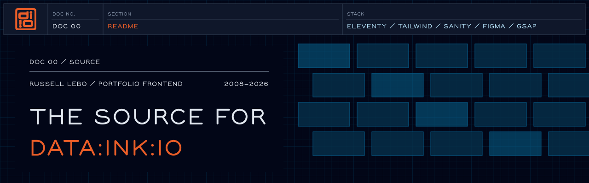
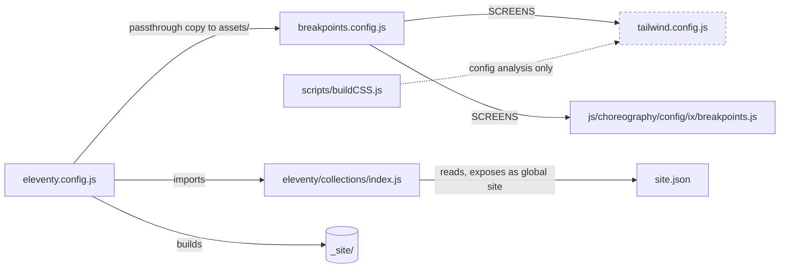

# dataink.io

This is the Eleventy site I always wanted to build. I will tell you why.
It started from a blank slate, so I'm confident I know what's up. With plugins that becomes more difficult.

## Practices

- atomic design & modularity
- sidecars, READMEs, and embedded documentation
- findability, discoverability, maintainability
- AIX: graphify, skills
- low barrier to entry

## Structure

At root:

- eleventy.config
- site.json
- tailwind.config
- postcss.config
- breakpoints.config

Solid lines are imports or reads that affect the build. Dashed boxes mark the two files that don't drive the build right now. The Tailwind v4 CLI builds `styles/main.css`, which has no `@config` directive, so `tailwind.config.js` reaches only the build logger. `postcss.config.js` names `@tailwindcss/postcss`, but nothing in the build uses PostCSS and that package isn't installed.

### Assets

- fonts
- icons
- images
- js
- storyboards
- svg
- tiles

### Data/Sanity

- client
- projections
- queries
- services
- transforms
- queries.js

### Eleventy

- collections
- filters
- plugins
- services
- shortcodes

### Figma

- api
- models
- services
- utils
- views

### IA

MD files for pages and navigation

### JS

- choreography
- displays
- effects
- interstitials
- layouts
- lightbox
- preloader
- utils
- vendor

### Scripts

### Specs

### Styles

- backgrounds
- components
- typography
- utilities
- base.css
- colors.css
- decorations.css
- sizes.css
- main.css

### Test

### Views

- atoms
- layouts
- molecules
- organisms
- pages
- templates

## License

[MIT](LICENSE)

---

<!-- readme-index:start -->

## Index

- [assets/](assets/README.md)
- [data/](data/)
- [docs/](docs/README.md)
- [eleventy/](eleventy/README.md)
- [figma/](figma/README.md)
- [graphify-out/](graphify-out/)
- [ia/](ia/)
- [js/](js/README.md)
- [responsive-testing/](responsive-testing/README.md)
- [scripts/](scripts/README.md)
- [specs/](specs/)
- [styles/](styles/README.md)
- [test/](test/README.md)
- [views/](views/README.md)
- [breakpoints.config.js](breakpoints.config.js)
- [breakpoints.config.md](breakpoints.config.md)
- [CLAUDE.md](CLAUDE.md)
- [eleventy.config.js](eleventy.config.js)
- [eleventy.config.md](eleventy.config.md)
- [frontend.code-workspace](frontend.code-workspace)
- [IA.canvas](IA.canvas)
- [package-lock.json](package-lock.json)
- [package.json](package.json)
- [postcss.config.js](postcss.config.js)
- [README.canvas](README.canvas)
- [site.json](site.json)
- [tailwind.config.js](tailwind.config.js)
<!-- readme-index:end -->
