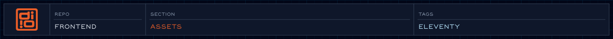

Static files the site serves as-is.

<!-- readme-header: generated by `npm run build:readme`, edit the script, not this block -->

<!-- /readme-header -->

# Assets

Static files the site serves as-is.

## What's here

- `fonts/`: self-hosted web fonts
- `icons/`, `images/`, `svg/`, `tiles/`: graphics
- `storyboards/`: exported storyboard SVGs
- `js/`: the built animation bundle (git-ignored, made by `npm run build:js`)

## See also

- [Fonts](fonts/README.md)

<!-- readme-index:start -->
## Index

- [fonts/](fonts/README.md)
- [icons/](icons/)
- [images/](images/)
- [js/](js/)
- [storyboards/](storyboards/)
- [svg/](svg/)
- [tiles/](tiles/)
<!-- readme-index:end -->
