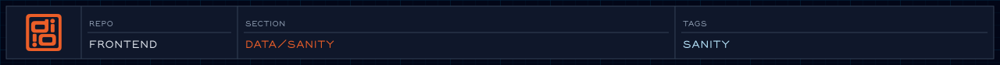

<!-- readme-header: generated by `npm run build:readme`, edit the script, not this block -->

<!-- /readme-header -->

Build-time code that fetches CMS content and shapes it for Eleventy.

# Sanity data

Fetches content from Sanity when the site builds and turns it into Eleventy collections.

## What's here

- `queries.js` and `queries/`: the GROQ queries, gathered into one list
- `projections/`: reusable pieces of those queries
- `transforms/`: functions that tidy raw results into what templates need
- `services/`: runs the queries, caches results, registers collections
- `client/`: the Sanity client

## How it connects

- Uses the Sanity project described in [backend](https://github.com/datainkio/portfolio-backend).
- Feeds [eleventy/collections](../../eleventy/collections/index.md), which calls `init` from `services/`.

## Data flow

1. [`eleventy/collections/sanity.js`](../../eleventy/collections/sanity.md) re-exports `init` from `services/`. `eleventy/collections/index.js` runs it before navigation.
2. `services/sanityService.js` reads config from the environment, builds the client, and runs every query in `CMS_QUERIES` (in parallel unless `SANITY_PARALLEL=false`).
3. Each result is cached with `@11ty/eleventy-fetch`, passes through the matching `transforms/` function, and is stored by query id.
4. The results become the `cms` global (`cms.<id>`) and one Eleventy collection per id (`collections.<id>`). `cmsMeta` holds the non-secret config.
5. If `SANITY_PROJECT_ID` or `SANITY_DATASET` is missing, the step is skipped and `cms` is empty.

## Collections

Each id below is a query in `queries/`, and a collection of the same name:

- `siteSettings`, `home`, `contact`, `userGuide`, `navigation`
- `organizations`, `industries`, `activities`, `roles`, `outcomes`
- `projects`, `projectsLanding`, `projectPages`, `projectsByIndustry`
- `posts`, `postsLanding`, `postPages`
- `documentationLanding`, `sitePages`
- `awards`, `imageAssets`

## Configuration

Environment variables only (loaded from `.env`):

- `SANITY_PROJECT_ID` and `SANITY_DATASET`: required
- `SANITY_READ_TOKEN`: optional; when set, the CDN is turned off
- `SANITY_API_VERSION`
- `SANITY_PERSPECTIVE`: defaults to `published`
- `SANITY_USE_CDN`
- `SANITY_PARALLEL`
- `SANITY_CACHE_DURATION`: default cache window, `1d` if unset
- `SANITY_FORCE_REFRESH`: any value but `false` fetches fresh; `false` lets dev builds use the cache. Production builds (`ELEVENTY_RUN_MODE=build`) always fetch.

<!-- readme-index:start -->

## Index

- [client/](client/)
- [projections/](projections/README.md)
- [queries/](queries/README.md)
- [services/](services/README.md)
- [transforms/](transforms/README.md)
- [queries.js](queries.js)
- [queries.md](queries.md)
<!-- readme-index:end -->
