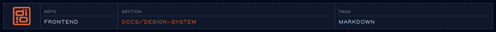

<!-- readme-header: generated by `npm run build:readme`, edit the script, not this block -->


[](https://github.github.com/gfm/)

<!-- /readme-header -->

Generated inventory of the design system as it exists in code.

# Design system

The baseline for deriving a design system from the codebase: what tokens are
declared, which utilities the templates use, and where the values that have no
token live.

## What's here

- [inventory.md](inventory.md): summary tables, regenerated by `npm run inventory:design`
- [figma-worklist.md](figma-worklist.md): the styles and layers created in Figma on 2026-11-06, kept as a record
- [adr-0001-figma-owns-design-tokens.md](adr-0001-figma-owns-design-tokens.md): who owns which tokens, and why
- [adr-0002-figma-library-variables-are-the-design-tokens.md](adr-0002-figma-library-variables-are-the-design-tokens.md): proposed; moves the token source from the old Figma file to the design-system library's variables
- [adr-0003-figma-owns-mapped-component-colours.md](adr-0003-figma-owns-mapped-component-colours.md): proposed; extends Figma ownership from tokens to a mapped component's colour utilities, starting with Button
- `inventory.json`: the complete data behind the inventory, including per-file class lists. It is generated locally and gitignored, because Tailwind scans tracked files and would turn token names into classes.

The inventory is a build artifact. Edit the script, not the output:
[`scripts/generate/inventoryDesignSystem.js`](../../scripts/generate/inventoryDesignSystem.md).

## See also

- [Design system spec](../../specs/design-system.spec.md)
- [Component API spec](../../specs/views/component-api.views-spec.md)
- [Figma sync](../../figma/README.md)
- [Motion tokens](../../js/choreography/tokens/motion/motion.md)

```mmd
flowchart TB
    subgraph SOURCES["Token sources (who owns what)"]
        FIG["Figma library<br/>variables · Shadow effect styles<br/>(read through its Tokens page)"]
        MOTJS["js/choreography/tokens/motion/motion.js"]
        HAND["styles/typography/<br/>font faces + families (by hand)"]
    end

    subgraph SYNC["Sync commands"]
        BD["npm run build:design<br/>(fetchFigma.js → VariablesService → PaletteService / TokenService)"]
        BM["npm run build:motion"]
    end

    subgraph GEN["Generated CSS — never hand-edit"]
        COL["styles/colors.css<br/>palette: primary · secondary · tertiary<br/>accent · neutral · semantic-*"]
        TOK["styles/tokens.css<br/>spacing · containers · radius · shadow<br/>tracking · type size/leading/weight"]
        MOT["styles/motion.css<br/>durations + easings"]
    end

    subgraph CSS["styles/main.css — import order is critical"]
        direction TB
        L1["1 fonts (typography/imports.css)"]
        L2["2 Tailwind v4 + typography plugin"]
        L3["3 base.css · sizes.css"]
        L4["4 theme layer:<br/>colors · fontFamilies · tokens · motion"]
        L5["5 decorations.css (halftone, stripes)<br/>utilities/ mask · text · reduced-motion"]
        L6["6 components/ hanko · portable-text"]
        L1 --> L2 --> L3 --> L4 --> L5 --> L6
    end

    subgraph COMP["Components — views/ (atomic design)"]
        direction TB
        ATOM["atoms/<br/>button · cta · heading · icon · gel<br/>pixelator · award · organization"]
        MOL["molecules/<br/>card · callout · list · stats · navigation<br/>figure · lightbox · project-metadata …"]
        ORG["organisms/<br/>section (hero · work · organizations · awards · process)<br/>header · footer · forms · navigation"]
        LAY["layouts/ + templates/ + pages/"]
        ATOM --> MOL --> ORG --> LAY
    end

    API["Component API contract<br/>one render(params = {}) macro<br/>classes + styles slots · no ambient context<br/>+ co-located .md sidecar (## Params)"]

    subgraph REF["Living reference — /docs/design/"]
        IA["ia/docs/design/<br/>atoms · molecules · organisms · layouts · templates · tokens"]
        DOC["layouts/design-doc.njk<br/>specimens · call code · params from sidecar"]
        RDR["eleventy/collections/designSystem.js<br/>eleventy/filters/design.js"]
        IA --> DOC
        RDR --> DOC
    end

    subgraph ENF["Enforcement — npm run validate"]
        E1["lint:palette<br/>no off-palette colours, no repeated arbitrary values"]
        E2["lint:frontmatter"]
        E3["audit:sidecars"]
        E4["check:motion<br/>motion.css == fresh build"]
        E5["test + quick<br/>broken imports fail the build"]
    end

    SPEC["specs/design-system.spec.md<br/>+ ADR 0001: Figma owns design tokens"]

    FIG --> BD
    BD --> COL
    BD --> TOK
    MOTJS --> BM --> MOT
    HAND --> L1
    COL --> L4
    TOK --> L4
    MOT --> L4

    CSS -- "tokens reached via utilities<br/>(bg-neutral-900, p-18)" --> COMP
    API -. governs .-> COMP
    COMP -- "mirrored path 1:1" --> IA
    GEN -- "readers: colors, designTokens" --> RDR

    SPEC -. defines .-> SOURCES
    SPEC -. defines .-> API
    E1 -. guards .-> COMP
    E1 -. guards .-> CSS
    E2 -.-> IA
    E3 -.-> COMP
    E4 -.-> MOT
    E5 -.-> REF
```
