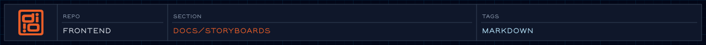
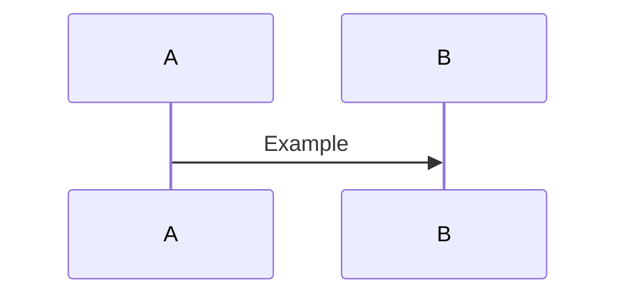

Animation storyboards written in Markdown with Mermaid.

<!-- readme-header: generated by `npm run build:readme`, edit the script, not this block -->


[](https://github.github.com/gfm/)

<!-- /readme-header -->

# Storyboards

Animation sequences sketched as Mermaid diagrams inside Markdown pages.

## How it works

A page tagged `storyboard` uses the storyboards layout, which renders Mermaid in the browser. Example:

````markdown
---
layout: layouts/storyboards.njk
tags: ["storyboard"]
---


````

To export SVGs, see `npm run diagrams:export`.

## See also

- [Storyboards layout](../../views/layouts/storyboards.njk)
- [Docs](../README.md)

<!-- readme-index:start -->
## Index

No sibling files or folders.
<!-- readme-index:end -->
