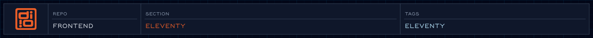

<!-- @format -->

<!-- readme-header: generated by `npm run build:readme`, edit the script, not this block -->

<!-- /readme-header -->

# Eleventy setup

Custom code that extends Eleventy, the static site generator behind the site.

## What's here

- `collections/`: builds the page and navigation collections
- `filters/`: helpers for templates (dates, strings, arrays, colors)
- `shortcodes/`: reusable template snippets
- `plugins/`: Eleventy plugins and the HTML minify step
- `services/`: the navigation builder and the Tailwind build logger

## How it connects

- `eleventy.config.js` at the repo root imports collections, plugins, filters and shortcodes.
- Collections pull CMS content from [data/sanity](../data/sanity/README.sanity.md).
- Templates in `views/` use the filters and shortcodes.

## See also

- [Architecture](../docs/architecture.md)
