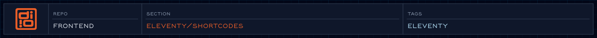

Reusable snippets templates can call.

<!-- @format -->

<!-- readme-header: generated by `npm run build:readme`, edit the script, not this block -->

<!-- /readme-header -->

# Shortcodes

Snippets you call from a template, like ``.

## What's here

- `collapsible.js`: accordion block
- `image.js`: adds classes to picture markup
- `loremipsatron.js`: placeholder text
- `shortcodes.js`: registers them

## How it connects

- Registered from `eleventy.config.js`; used in `views/`.

## See also

- [Eleventy setup](../README.md)

<!-- readme-index:start -->
## Index

- [collapsible.js](collapsible.js)
- [collapsible.md](collapsible.md)
- [image.js](image.js)
- [image.md](image.md)
- [loremipsatron.js](loremipsatron.js)
- [loremipsatron.md](loremipsatron.md)
- [shortcodes.js](shortcodes.js)
- [shortcodes.md](shortcodes.md)
<!-- readme-index:end -->
