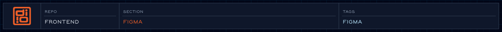

Pulls published color and text styles from the Figma file and writes them as Tailwind theme tokens.

<!-- readme-header: generated by `npm run build:readme`, edit the script, not this block -->


[](https://www.figma.com)

<!-- /readme-header -->

# Figma token sync

Reads color and text styles from the Figma file and writes them as Tailwind v4 theme variables, so `accent/500` in Figma becomes `--color-accent-500` and `text-accent-500` in CSS.

## What's here

- `api/`: Figma REST client
- `services/`: fetch the file, sort styles, call the writers
- `models/`: the Figma fields we read
- `views/`: writers for each output file
- `utils/`: turns a style node into a model

## Run it

```bash
npm run build:design   # sync, then rebuild CSS
```

Needs `FIGMA_TOKEN` and `FIGMA_FILE_ID` in `.env` (see `.env.example`). `npm run quick` and the deploy workflows skip the sync.

It writes `styles/colors.css`, `styles/typography/fontFamilies.css` and `styles/typography/imports.css`. Those files are generated, so don't edit them by hand.

## Good to know

- Only color fills and font family names become tokens. Font sizes, line heights and spacing come from Tailwind defaults or hand-written CSS.
- `imports.css` and `fontFamilies.css` have been edited by hand since the last sync (self-hosted fonts, fallback stacks). Port those changes into `views/tailwind/` before syncing again.

## How it connects

- The orchestrator is `scripts/fetchFigma.js`.
- Output is imported by [styles](../styles/README.md).

## See also

- [Typography](../styles/typography/README.md)

<!-- readme-index:start -->
## Index

- [api/](api/README.md)
- [models/](models/README.md)
- [services/](services/README.md)
- [utils/](utils/)
- [views/](views/README.md)
- [index.js](index.js)
<!-- readme-index:end -->
