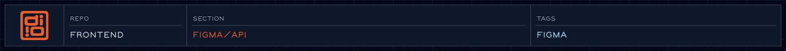

<!-- readme-header: generated by `npm run build:readme`, edit the script, not this block -->

<!-- /readme-header -->

Wraps the Figma REST API. `FigmaClient.js` performs the requests; `endpoints.js` holds the URL shapes.
