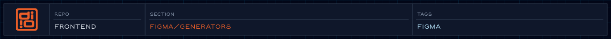

<!-- readme-header: generated by `npm run build:readme`, edit the script, not this block -->

<!-- /readme-header -->

Figma Plugin API scripts that build pages in the design-system library for the REST sync to read.

These run inside Figma, through the Figma MCP's `use_figma` tool or a development plugin, not in Node. `tokensPage.js` builds the `Tokens` page that [VariablesService](../services/VariablesService.md) reads.
