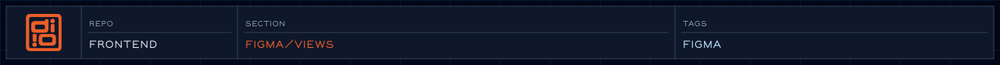

<!-- readme-header: generated by `npm run build:readme`, edit the script, not this block -->

<!-- /readme-header -->

Emitters that render resolved Figma tokens into Tailwind source files, and component colours into Nunjucks templates.

Each subfolder targets one consumer. The Tailwind output is generated — never hand-edit the files it produces. In a template, only the colour utilities in its `variants` map are written.

<!-- readme-index:start -->
## Index

- [nunjucks/](nunjucks/README.md)
- [tailwind/](tailwind/README.md)
<!-- readme-index:end -->
