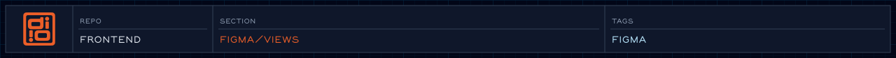

Emitters that render resolved Figma tokens into Tailwind and Eleventy source files.

<!-- readme-header: generated by `npm run build:readme`, edit the script, not this block -->

<!-- /readme-header -->

Each subfolder targets one consumer. Output is generated — never hand-edit the files these produce.

<!-- readme-index:start -->
## Index

- [eleventy/](eleventy/README.md)
- [tailwind/](tailwind/README.md)
<!-- readme-index:end -->
