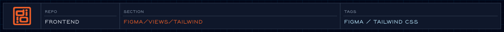

<!-- readme-header: generated by `npm run build:readme`, edit the script, not this block -->

<!-- /readme-header -->

Tailwind-targeted emitters for the palette and the design tokens.

These write `styles/colors.css` and `styles/tokens.css`, which `build:design` overwrites — never hand-edit them.

<!-- readme-index:start -->
## Index

- [PaletteFile.js](PaletteFile.js)
- [PaletteFile.md](PaletteFile.md)
- [TokensFile.js](TokensFile.js)
- [TokensFile.md](TokensFile.md)
<!-- readme-index:end -->
