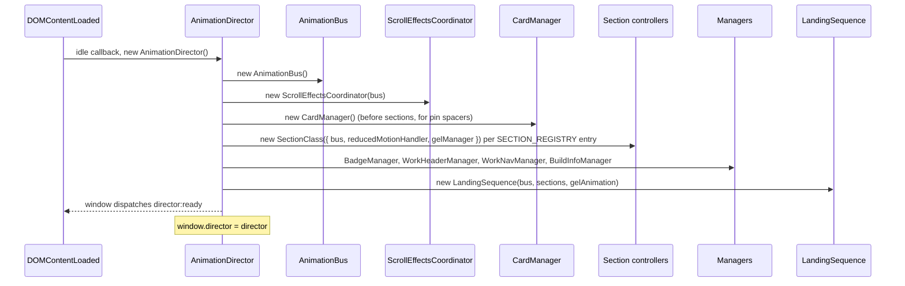

# AnimationDirector.js

In its role as the master choreography controller, AnimationDirector is the second gate for the #preloader strategy; builds bus, stage, sections, managers, LandingSequence, then emits director:ready (or 8000ms timeout + console.warn).

1. The script self-initializes on load ^43ea41
2. Initialize AnimationBus ^853775
3. Initialize ScrollEffectsCoordinator ^72a792
4. Initialize managers ^b5aa46
5. Initialize LandingSequence ^f25455
6. 📍Dispatch EVENTS.system.directorReady ^e44458

## Boot sequence

`AnimationDirector.js` waits for `DOMContentLoaded`, defers to idle (`requestIdleCallback`, 150ms timeout, with a `setTimeout` fallback), then constructs one director and exposes it as `window.director`. The constructor builds everything in this order and ends by dispatching `EVENTS.system.directorReady`. It does not start the landing sequence; `LandingSequence` waits for the preloader handoff (`preloader:out`).

Debug access: `window.director.getSections()`, `getSequence()`, `getStage()`, `restart()` and `destroy()` (a destroyed director can't be reused).
