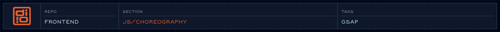
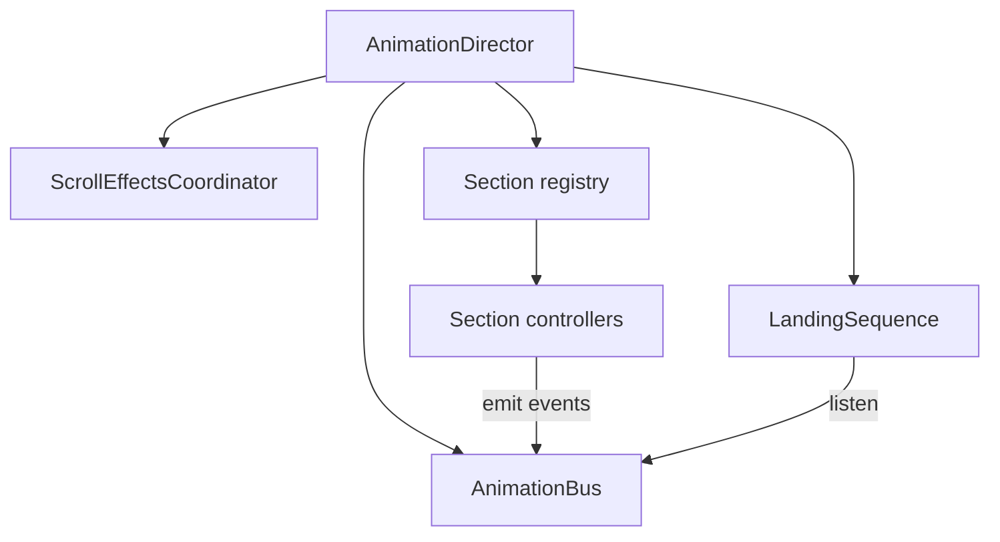

<!-- @format -->

<!-- readme-header: generated by `npm run build:readme`, edit the script, not this block -->

<!-- /readme-header -->

# Choreography

The system that animates the homepage. Sections announce what they are doing on a shared event bus, and a small sequence listens and cues the next step, so no section needs to know about another.

## How it runs

1. `AnimationDirector` boots when the page is idle, builds the bus, the scroll effects, and one controller per section.
2. It fires `director:ready`. The preloader fires `preloader:out` when its splash is done.
3. `LandingSequence` waits for both, then plays the landing animation. Nothing bypasses this gate.

Rules every animation follows:

- Sections talk through `AnimationBus` events, never by calling each other.
- JS finds elements through `data-*-el` attributes, not CSS classes.
- Every ScrollTrigger animation has a reduced-motion branch.

## What's here

- `AnimationDirector.js` - the entry point; owns everything below
- `system/` - the bus, the section base classes, and the section registry
- `organisms/` - one controller per page section (hero, work, organizations, awards, background, card)
- `templates/landing/` - `LandingSequence`, the intro choreography
- `managers/` - page-wide behavior such as scroll smoothing and header hiding ([details](managers/README.managers.md))
- `atoms/`, `molecules/`, `tokens/` - reusable motion pieces, from timing values up to small compositions
- `config/` - event names, selectors and motion settings ([details](config/README.config.md))
- `pages/` - animations for pages outside the home sections ([details](pages/README.pages.md))

## How it connects

- Built by esbuild from `AnimationDirector.js` into `assets/js/choreography/bundle.js`.
- Waits on the [preloader](../preloader/README.preloader.md) before playing.
- Uses [effects/gel](../effects/gel/README.gel.md) for the liquid background shapes.
- Run `window.director` in the browser console to inspect sections or replay the sequence.

## See also

- [GETTING_STARTED.md](GETTING_STARTED.md) - a walkthrough for adding a section
- [Animation specs](../../specs/animation/README.animation.md)
- [Motion accessibility policy](../../specs/animation/motion-accessibility-policy.md)
