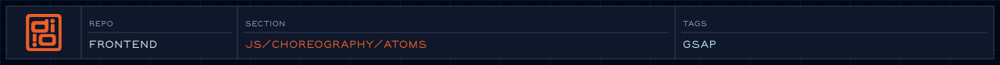

The smallest motion pieces: single GSAP animations built from a few options.

<!-- readme-header: generated by `npm run build:readme`, edit the script, not this block -->

<!-- /readme-header -->

# Atoms

The smallest motion pieces: each one builds a single GSAP animation from a few options.

## What's here

- `fade/`, `slide/`, `scale/` - basic entrances
- `clip-reveal/` - reveal through a clipping shape
- `text-split-reveal/` - animate text by line or word
- `stagger-reveal/` - reveal a group one item after another
- `parallax/` - depth on scroll
- `index.js` - exports all of them

## How it connects

- [Molecules](../molecules/) combine atoms into section-level motion.
- Timing and easing values come from `../tokens/motion/` and [config](../config/README.md).

## See also

- [Choreography](../README.md)

<!-- readme-index:start -->
## Index

- [clip-reveal/](clip-reveal/)
- [fade/](fade/)
- [parallax/](parallax/)
- [scale/](scale/)
- [slide/](slide/)
- [stagger-reveal/](stagger-reveal/)
- [text-split-reveal/](text-split-reveal/)
- [index.js](index.js)
- [index.md](index.md)
<!-- readme-index:end -->
