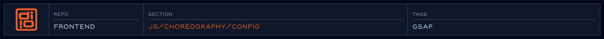

<!-- readme-header: generated by `npm run build:readme`, edit the script, not this block -->

<!-- /readme-header -->

# Config

Names, motion settings, and defaults shared across the choreography code. Nothing here touches the page.

## What's here

- `contracts/` - the shared vocabulary: `EVENTS` (event names), `SELECTORS` (section ids), `TIMELINE_IDS`
- `ix/` - motion tuning that changes as the design evolves: `motion.js`, `breakpoints.js`, `profiles.js` (per-breakpoint and reduced-motion variants), `scrolltriggers.js`, and `presets/` ([details](ix/presets/README.md))
- `displays/` - defaults for the ruler overlay
- `index/` - one barrel that re-exports the above

## Where things go

- A name or id used by several modules goes in `contracts/`.
- A section's timing and transform values go in `ix/presets/<section>.js`.
- A section's ScrollTrigger settings live beside the section, not here.
- Code that builds or draws things belongs in the runtime modules, not config.

## How it connects

- Imported by sections, managers, and atoms through `config/index/index.js`.
- Motion tokens come from `../tokens/motion/`.

## See also

- [Contracts](contracts/README.md)
- [Choreography](../README.md)
