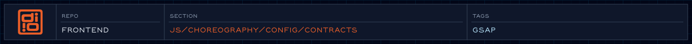

Canonical shared terms for choreography runtime.

<!-- readme-header: generated by `npm run build:readme`, edit the script, not this block -->

<!-- /readme-header -->

# Contracts

The shared vocabulary of the choreography code: event names, section selectors, and timeline ids.

## What's here

- `events/events.js` - `EVENTS`, including `director:ready` and `preloader:out`
- `selectors/selectors.js` - `SELECTORS`, the DOM id of each section
- `timelines/timelines.js` - `TIMELINE_IDS`
- `contracts.js` - re-exports the three

## How it connects

- Sections, managers and the landing sequence all import from here instead of writing strings inline.
- Prefer adding new names over renaming old ones, since many files depend on them.

## See also

- [Config](../README.md)

<!-- readme-index:start -->
## Index

- [events/](events/)
- [selectors/](selectors/)
- [timelines/](timelines/)
- [contracts.js](contracts.js)
- [contracts.md](contracts.md)
<!-- readme-index:end -->
