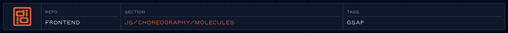

<!-- readme-header: generated by `npm run build:readme`, edit the script, not this block -->

<!-- /readme-header -->

Section-level motion built from atoms: the variants a section can run.

# Molecules

Compositions of atoms that make one recognisable piece of motion: a hero
intro, a card's scroll behaviour, a group of items revealing in turn. Most
are factories that return a GSAP timeline and leave playing it to the caller.

## What's here

- `hero-motion/`, `card-motion/`, `award-motion/`, `process-motion/` - the variants each section can run; the folder's own module picks one by name
- `scroll-reveal-group/` - reveals a list of items as they scroll into view
- `section-header-intro/`, `svg-reveal/`, `video-reveal/`, `gel-transition/`, `band-motion/` - single-purpose pieces shared across sections
- `article-nav-toggle/` - the article navigation's open and close
- `index.js` - exports all of them

## How it connects

- Built from [atoms](../atoms/README.md) and the presets in [config](../config/README.md).
- Chosen and played by the animations modules in [organisms](../organisms/README.md). The variant name comes from the section's motion profile.
- `hero-motion/` and `award-motion/` each have a `reduced` variant, which the `reduced` profile selects.

## See also

- [Choreography](../README.md)
