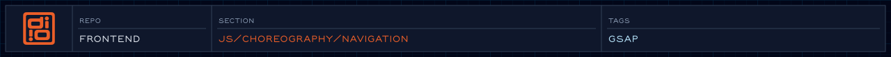

<!-- readme-header: generated by `npm run build:readme`, edit the script, not this block -->

<!-- /readme-header -->

# Navigation

Page-to-page transitions: play an outro, then navigate. Not currently loaded
by the site.

## What's here

- `navigation.js` - on `DOMContentLoaded`, intercepts clicks on `a.sexy-link`,
  plays an outro and follows the link when it completes

## Status

Nothing imports `navigation.js` and no template loads it, so it doesn't run
(checked 2026-11-18). `pages/Project/Project.js` carries the same
`a.sexy-link` handler. Treat this folder as a sketch for page transitions, not
live behaviour.

## See also

- [Choreography](../README.md)
