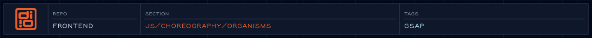

<!-- readme-header: generated by `npm run build:readme`, edit the script, not this block -->

<!-- /readme-header -->

One controller per page section, each with its animations and its scroll triggers.

# Organisms

A page section's motion, as one unit. Each folder holds a controller that
extends `AbstractSection`, an animations module that builds its timelines,
and a triggers module that holds its ScrollTrigger settings.

## What's here

- `hero/`, `work/`, `organizations/`, `awards/` - the homepage sections, in page order
- `background/` - the background video and its perspective tilt
- `card/` - project cards, and `CardManager`, which builds one controller per card
- `process/` - registered, but its section isn't rendered on any page
- `index.js` - exports all of them

## How it connects

- Controllers extend the base classes in [system](../system/README.md) and are listed in its registry.
- Animations modules pick a variant from [molecules](../molecules/README.md), chosen per breakpoint by the profiles in [config](../config/README.md).
- `LandingSequence` in [templates](../templates/README.md) cues the sections in order.

## See also

- [Choreography](../README.md)
