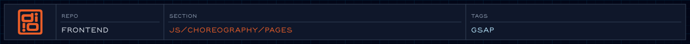

<!-- readme-header: generated by `npm run build:readme`, edit the script, not this block -->

<!-- /readme-header -->

# Pages

Animations for pages that are not part of the homepage sections. Today that is `Project/`, the intro for a project page.

## How it connects

- The Director can load a page script based on `data-page-type` on `<body>`.

## See also

- [Choreography](../README.md)

<!-- readme-index:start -->
## Index

- [Project/](Project/)
<!-- readme-index:end -->
