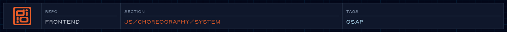

<!-- readme-header: generated by `npm run build:readme`, edit the script, not this block -->

<!-- /readme-header -->

The runtime core: the event bus, the section base classes, and the registry.

# System

The runtime core every section is built on. Nothing here animates anything
by itself; it provides the lifecycle, the bus and the GSAP setup that the
other layers use.

## What's here

- `AnimationBus.js` - the event bus sections talk through; `NullAnimationBus.js` is its no-op stand-in
- `AbstractSection.js` - the base section controller: lifecycle, events, per-breakpoint motion
- `AbstractSectionAnimations.js`, `AbstractSectionTriggers.js` - a section's timelines and its viewport trigger
- `PromiseResolverQueue.js` - makes `await section.playIntro()` work
- `registry.js` - which controller runs for which section key
- `gsap.js` - the single GSAP import, with plugins registered

## How it connects

- [Organisms](../organisms/) extend the base classes here.
- `AnimationDirector` creates the bus and builds a controller per registry entry.
- Names and settings come from [config](../config/README.md).

## See also

- [Choreography](../README.md)
