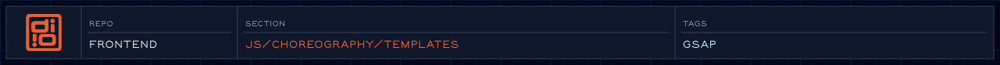

<!-- readme-header: generated by `npm run build:readme`, edit the script, not this block -->

<!-- /readme-header -->

Page-level sequences that cue the sections in order.

# Templates

Choreography for a whole page: what plays first, what waits for what.

## What's here

- `landing/` - `LandingSequence`, the homepage's opening sequence
- `index.js` - exports it

## How it connects

- `LandingSequence` waits for `director:ready` and `preloader:out`, then cues the background video and the hero in order, awaiting each step before the next.
- The sections it cues are the controllers in [organisms](../organisms/README.md).

## See also

- [Choreography](../README.md)
