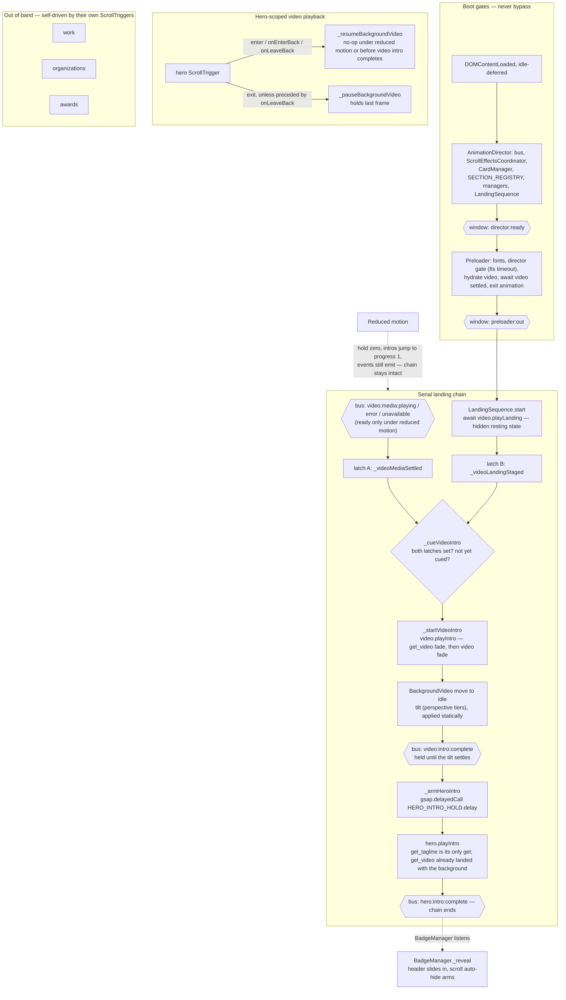

# LandingSequence

Narrative pacing for the homepage. Owns no DOM and no ScrollTrigger — it listens on `AnimationBus` and cues section lifecycle methods in order.

## Methods

- `_onPreloaderOut()` — the `preloader:out` handler: `start()`, unless a debug hold applies
- `_isHeld(hold)` — whether `?hold=` names a `LANDING_HOLDS` point; logs how to resume
- `start()` — stage the video's landing state, then latch it
- `_cueVideoIntro()` — join the two latches; run the video intro once
- `_startVideoIntro()` — fade the background video in
- `_armHeroIntro()` — hold a beat, then play Hero's intro
- `_pauseBackgroundVideo()` / `_resumeBackgroundVideo()` — Hero-scoped playback gate
- `_registerListeners()` — subscribe to the bus events below
- `reset()` / `destroy()`

## Debug hold

`?hold=preloader-out` stops the chain where it would start: the preloader lifts,
`preloader:out` fires, and `LandingSequence` does not call `start()`. Only the
page background shows. The logger prints the hold and how to resume:

```js
window.director.getSequence().start();
```

That continues the normal chain. The video-settled listener is registered in
the constructor and keeps listening during the hold, so a settle that arrived
while held is already latched and `start()` joins it in `_cueVideoIntro`.

Holds are listed in `LANDING_HOLDS` (URL value plus resume hint) and read with
`getLandingHold()`, modeled on `getCardVariantOverride()` in
`config/ix/profiles.js` (SSR-safe, `URLSearchParams`). To add another point,
add an entry and check it with `_isHeld()` where the chain passes that point.

## Events

- `preloader:out` (window) — the preloader completes its outro
- `video:media:playing` | `error` | `unavailable` — the background video settles; `video:media:ready` counts only under reduced motion
- `video:intro:complete` — the background video completes its intro
- `hero:enter` — the hero section enters the view
- `hero:onEnterBack` — the hero section backs into the view
- `hero:onLeaveBack` — the hero section backs out of the view
- `hero:exit` — the hero section exits the view (either direction)

## Sequence

Each `Visitor` note says what is on screen at that point; the rest is the mechanism behind it. Phase 1 is the landing chain: two latches join in `_cueVideoIntro`, then the video intro, the hold, and the hero intro run in series. Phase 2 is Hero's ScrollTrigger gating background-video playback.

```mermaid
sequenceDiagram
  autonumber
  actor U as Visitor
  participant W as window / Preloader
  participant Bus as AnimationBus
  participant LS as LandingSequence
  participant Video as BackgroundVideo (sections.video)
  participant G as gsap.delayedCall
  participant Hero as Hero (sections.hero)
  participant Hdr as BadgeManager

  Note over LS: constructor: listen once for preloader:out on window,<br/>then subscribe to Bus events (_registerListeners)
  Note over U: First visit: the preloader splash (logo and subtitle) fills<br/>the screen and scrolling is locked.<br/>Return visit: no splash, the page paints straight away.

  rect rgba(120,120,120,0.08)
  Note over U,Hdr: Phase 1. Landing chain. Two latches (A and B), arrival order not fixed
  par Latch A: video settles (usually first, before preloader:out)
    Note over U: Still the splash. Behind it the video hydrates<br/>and starts playing, out of sight.
    Video-)Bus: video:media:playing | error | unavailable<br/>| ready (counts only if reduced motion)
    Bus->>LS: settled handler
    LS->>LS: _videoMediaSettled = true
    LS->>LS: _cueVideoIntro() (returns early until B is set)
  and Latch B: preloader hands off
    Note over U: The splash plays its exit and lifts.
    W-)LS: preloader:out
    LS->>LS: start(), remove window listener
    LS->>Video: await playLanding() (stage autoAlpha 0)
    Video-->>LS: resolved (errors are logged and swallowed)
    Note over U: Page is up, but the video is held invisible.
    LS->>LS: _videoLandingStaged = true
    LS->>LS: _cueVideoIntro()
  end
  Note over LS: Both latches set and _videoIntroCued is false,<br/>so set _videoIntroCued = true
  LS->>Video: await playIntro() (gel_video fades in, then the video; play() as safety net)
  Note over U: The gel_video gel fades in, then the background video<br/>fades in already darkened and in motion, never a frozen poster frame.
  Note over Video: Move to idle: the tilt (perspective tiers) is applied<br/>statically; video:intro:complete follows, gel fully visible
  Note over U: The background rests in perspective with the video already<br/>darkened by gel_video (narrow screens: no tilt).
  Video-)Bus: video:intro:complete
  Bus->>LS: introComplete handler
  LS->>LS: _videoIntroComplete = true
  LS->>G: _armHeroIntro(): delayedCall(hold)<br/>hold = 0 if reduced motion, else HERO_INTRO_HOLD.delay
  Note over U: A short beat: the video plays on its own.
  G-->>LS: hold elapsed, _heroHoldCall = null
  LS->>Hero: playIntro()
  Note over U: The manifesto arrives: its context line rises and fades in,<br/>the title's letters cascade up into place, then the keywords<br/>"just", "informed" and "engaged" light up in secondary-600.
  Hero-)Bus: hero:intro:complete (chain ends)
  Bus->>Hdr: _reveal()
  Note over U: The site header slides down from the top edge.<br/>From now on it hides on scroll down and returns on scroll up.
  end

  Note over U: Reduced motion: no splash animation, the video shows<br/>a still frame, the manifesto appears at rest, and the<br/>header appears without sliding. The same events still fire.

  rect rgba(120,120,120,0.08)
  Note over U,Hdr: Phase 2. Hero ScrollTrigger controls video play/pause
  Hero-)Bus: hero:enter (also fires at load)
  Bus->>LS: _heroLeftBackwards = false
  LS->>LS: _resumeBackgroundVideo()
  alt reduced motion OR video intro not yet complete
    LS-->>LS: no-op (landing chain still owns playback)
  else
    LS->>Video: videoEl.play() (rejection ignored)
  end

  Hero-)Bus: hero:onEnterBack
  Bus->>LS: _heroLeftBackwards = false
  LS->>Video: _resumeBackgroundVideo() (same gate)
  Note over U: Scrolling back up into the manifesto, the video moves again.

  alt Scroll down past Hero
    Hero-)Bus: hero:exit
    Bus->>LS: _heroLeftBackwards is false
    LS->>Video: videoEl.pause() (holds last frame for gel blend)
    Note over U: Past the manifesto, the video freezes on its last frame.<br/>The backdrop and the colour blend over it look unchanged,<br/>just still.
  else Scroll up above Hero's start
    Hero-)Bus: hero:onLeaveBack
    Bus->>LS: _heroLeftBackwards = true
    LS->>Video: _resumeBackgroundVideo() (same gate)
    Hero-)Bus: hero:exit (sent right after, dispatch is synchronous)
    Bus->>LS: _heroLeftBackwards is true, so clear it and return (no pause)
    Note over U: Back at the top of the page, the video keeps playing.
  end
  end

  Note over LS: destroy(): kill _heroHoldCall, reset all flags,<br/>unsubscribe Bus listeners, clear references
```

## Reduced motion

- The landing hold is zero: `_armHeroIntro` waits 0 instead of `HERO_INTRO_HOLD.delay`, so the hero intro follows `video:intro:complete` with no beat.
- A gated profile still emits the `…:intro:complete` events. `AbstractSection` jumps the intro to `progress(1)`, so the chain completes without motion instead of stalling.
- Under reduced motion `_resumeBackgroundVideo` is a no-op, so Hero's scroll gate never resumes the background video.

## Motion strategy



### Why it is shaped this way

- **The reveal is cued off the video's own media events.** It used to be `home:outro:complete` from HomeHeaderManager. That manager was first dropped from AnimationDirector, then deleted, so nothing emitted the cue and the video sat at autoAlpha 0. The `video:media:*` events always arrive (BackgroundVideo emits exactly one per path, with a 4 s failsafe), and `playing` means frames are moving, so the fade never reveals a still poster.
- **Two latches, one join.** The video usually settles _before_ `preloader:out` — the preloader holds its splash until the video reports. A timed-out director gate or a late video error can invert that. `_cueVideoIntro` waits for both the settled event and `playLanding()`, whichever comes last, and `_videoIntroCued` makes it run once.
- **`playLanding()` is awaited before latch B is set.** Revealing while `playLanding()` is still tweening toward autoAlpha 0 would be undone by it.
- **The chain ends at `hero:intro:complete`.** BadgeManager listens for it on home and reveals the header as the final beat. Pages without a hero reveal the header immediately.
- **Every link is an event, not a call.** Cross-section coordination goes through `AnimationBus` with `EVENTS` constants — `LandingSequence` never reaches into an organism's internals beyond its public `play*` methods and `video.videoEl`.
- **Timers are `gsap.delayedCall`, never `setTimeout`** — ticker-synced, pausable, killable in `destroy()`.
- **Hero's reveal is disengaged from scroll; its ScrollTrigger gates video playback.** The video plays while Hero is on screen and pauses once you scroll past it. Only play/pause changes — the gels in `#sizzle-background` blend against the video's painted frame, so a paused video holds the composite unchanged.
- **`exit` is not directional.** `AbstractSection._onLeaveBack` emits `onLeaveBack` and then `exit`. The `onLeaveBack` listener sets `_heroLeftBackwards` so the `exit` that follows skips the pause; scrolling up above Hero is the landing, where the video should keep playing.
- **No scroll-driven resume before the video intro completes.** Hero's ScrollTrigger fires `enter` at load; resuming on it would start the video underneath its own reveal.
- **The full-bleed gel arrives with the background, not with hero.** `gel_video` fades in as the first step of BackgroundVideo's intro, before the video does, so the video is already darkened when it appears (it replaced the hero's full-bleed gel on 2026-11-24). Hero keeps only `gel_tagline`. So the chain goes straight from the hold to `hero.playIntro()`. See [BackgroundVideo.md](../../organisms/background/BackgroundVideo.md#video-gel).

### Known drift

- The constructor comment `DISABLED INITIAL PRELOADER LISTENER FOR STYLING WORK ON PRELOADER VIEW` in `LandingSequence.js` is stale — the `preloader:out` listener is active.
- The badge replaced the global header on 2026-11-17 and renders on the homepage, so the final beat above (`hero:intro:complete` → `BadgeManager._reveal`) runs there again. See [homepage-initialization](../../../../specs/animation/homepage-initialization.animation.md).
