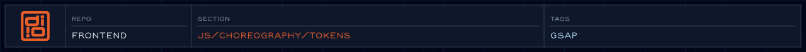

<!-- readme-header: generated by `npm run build:readme`, edit the script, not this block -->

<!-- /readme-header -->

# Tokens

The primitive motion values every preset and atom derives from. Nothing here
animates or touches the page; it is plain data.

## What's here

- `motion/motion.js` - `motionTokens`: duration, ease, distance, stagger,
  opacity, blur and layer order
- `index.js` - the barrel, re-exported by the choreography root `index.js`

## How it connects

- [Config](../config/README.md) re-exports `motionTokens` from `ix/motion.js`
  and wraps it: `motion.ease(name)` maps a CSS `cubic-bezier()` token to the
  nearest GSAP ease, because GSAP can't parse the CSS string.
- `npm run build:motion` copies the tokens to `styles/motion.css`, so CSS and
  GSAP read one source. `npm run check:motion` (part of `validate`) fails when
  the CSS has drifted from this file.

## See also

- [Choreography](../README.md)
