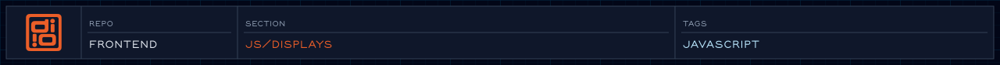

Visual ornamentation, debugging tools, and interactive demonstrations.

<!-- @format -->

<!-- readme-header: generated by `npm run build:readme`, edit the script, not this block -->

<!-- /readme-header -->

# Displays

Decorative and demonstration visuals.

## What's here

- `Ruler.js` - the measurement ruler overlay
- `blockframes/` - animated SVG wireframe layouts ([details](blockframes/README.md))
- `fibonacci.js`, `gen-grid.js`, `circle-packing.js` - experiments; `circle-packing.js` is a Highcharts demo and `gen-grid.js` loads libraries from a CDN

## How it connects

- Ruler defaults live in [choreography config](../choreography/config/README.md).
- The process section loads `blockframes/Blockframes.js` at runtime.

## See also

- [Ruler spec](../../specs/animation/ruler-display.animation-spec.md)

<!-- readme-index:start -->
## Index

- [blockframes/](blockframes/README.md)
- [circle-packing.js](circle-packing.js)
- [fibonacci.js](fibonacci.js)
- [gen-grid.js](gen-grid.js)
- [Ruler.js](Ruler.js)
<!-- readme-index:end -->
