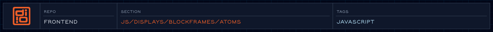

<!-- @format -->

<!-- readme-header: generated by `npm run build:readme`, edit the script, not this block -->

<!-- /readme-header -->

# Atoms

The smallest blocks, such as buttons, text fields and icons.

## What's here

All of the files here are empty placeholders so far.

## How it connects

- Part of [Blockframes](../README.md); `Painter.js` picks the right file by block class name.

## See also

- [Blockframes](../README.md)
