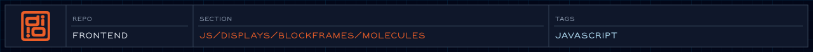

Molecules are the first level of component composition in the Blockframes system.

<!-- @format -->

<!-- readme-header: generated by `npm run build:readme`, edit the script, not this block -->

<!-- /readme-header -->

# Molecules

Small groups of atoms, such as cards and dropdowns.

## What's here

All of the files here are empty placeholders so far.

## How it connects

- Part of [Blockframes](../README.md); `Painter.js` picks the right file by block class name.

## See also

- [Blockframes](../README.md)

<!-- readme-index:start -->
## Index

- [Card.js](Card.js)
- [Chrome.js](Chrome.js)
- [Dropdown.js](Dropdown.js)
- [Map.js](Map.js)
- [Module.js](Module.js)
- [Sidebar.js](Sidebar.js)
- [Teaser.js](Teaser.js)
- [TextBlock.js](TextBlock.js)
- [TextInput.js](TextInput.js)
- [Video.js](Video.js)
<!-- readme-index:end -->
