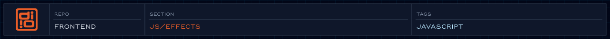

Collection of reusable visual effects for text, transitions, and gel animations.

<!-- @format -->

<!-- readme-header: generated by `npm run build:readme`, edit the script, not this block -->

<!-- /readme-header -->

# Effects

Visual effects built on GSAP and canvas.

## What's here

- `gel/` - the liquid background shapes ([details](gel/README.md))
- `image/halftone/` - a canvas halftone (dotted) image effect
- `layout/parallax.js` - a ScrollSmoother parallax example
- `Transitions.js` - a small `reveal` timeline helper

## How it connects

- The choreography `GelAnimationManager` uses `gel/`.
- The halftone effect is imported on its own by whichever page wants it.

## See also

- [Choreography](../choreography/README.md)

<!-- readme-index:start -->
## Index

- [gel/](gel/README.md)
- [image/](image/)
- [layout/](layout/)
- [Transitions.js](Transitions.js)
<!-- readme-index:end -->
