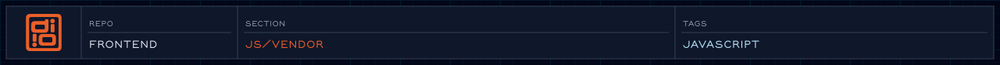

<!-- readme-header: generated by `npm run build:readme`, edit the script, not this block -->

<!-- /readme-header -->

# Vendor

Third-party scripts kept in the repo.

## What's here

- `gsap.min.js` - a local copy of GSAP

## How it connects

- The site itself loads GSAP and its plugins from `assets/js/vendor/gsap/` (copied from `node_modules`) through `choreography/system/gsap.js`.
- The preloader does not use GSAP; its outro is CSS.

## See also

- [Choreography](../choreography/README.md)
