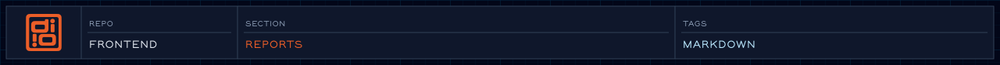

<!-- readme-header: generated by `npm run build:readme`, edit the script, not this block -->

<!-- /readme-header -->

Generated reports about the repo. Each one is written by a script. Edit the script, not the output.

# Reports

## What's here

- [design-system/](design-system/README.md): inventory of the design system as it exists in code, from `npm run inventory:design`
- [frontmatter-audit/](frontmatter-audit/README.md): before and after measurements of frontmatter debt, from `scripts/frontmatter/auditFrontmatter.js`
