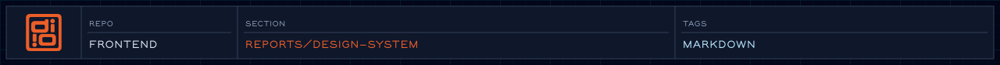

<!-- readme-header: generated by `npm run build:readme`, edit the script, not this block -->

<!-- /readme-header -->

Generated inventory of the design system as it exists in code.

# Design system inventory

The baseline for deriving a design system from the codebase: what tokens are declared, which utilities the templates use, and where the values that have no token live.

## What's here

- [inventory.md](inventory.md): summary tables, regenerated by `npm run inventory:design`
- `inventory.json`: the complete data behind the inventory, including per-file class lists. It is generated locally and gitignored, because Tailwind scans tracked files and would turn token names into classes.

The inventory is a build artifact. Edit the script, not the output: [`scripts/generate/inventoryDesignSystem.js`](../../scripts/generate/inventoryDesignSystem.md).

## See also

- [Design system spec](../../specs/design-system.spec.md)
- [Decision records](../../specs/decisions/README.md)
