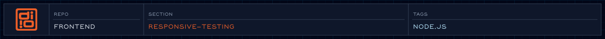

<!-- readme-header: generated by `npm run build:readme`, edit the script, not this block -->

<!-- /readme-header -->

# Responsive testing

Notes from checking the site at different screen sizes.

## What's here

- `viewports/`: [XS](viewports/01%20XS.md), [SM](viewports/02%20SM.md), [MD](viewports/03%20MD.md), [LG](viewports/04%20LG.md), [XL](viewports/05%20XL.md), [Base](viewports/00%20Base.md)
- `systems/`: per-feature notes, such as [hero](systems/hero.md) and [case cards](systems/case-cards.md)
- `audits/`: [homepage audit, 2026-05-20](audits/2026-05-20-homepage-audit.md)
- `issues/`: [pin release timing](issues/ISSUE-001-pin-release-timing.md), [metadata density](issues/ISSUE-002-metadata-density.md)
- `known-constraints/`: [viewport height](known-constraints/viewport-height.md), [Safari iOS](known-constraints/safari-ios.md)
- `screenshots/`, `recordings/`: evidence

## See also

- [Motion accessibility policy](../specs/animation/motion-accessibility-policy.md)
