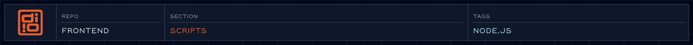

<!-- readme-header: generated by `npm run build:readme`, edit the script, not this block -->

<!-- /readme-header -->

# Scripts

The Node scripts that `npm run ...` calls.

## What's here

- `buildCSS.js`: compiles Tailwind
- `buildChoreography.js`: bundles the animation JS
- `fetchFigma.js`: syncs design tokens
- `buildReadmeAssets.js`: makes the README banner and strips
- `serveSite.js`, `buildPreview.js`: local preview
- `lintFrontmatter.js`, `auditFrontmatter.js`, `normalizeFrontmatter.js`: frontmatter checks
- `scaffold.js`: generates a new component
- `syncContent.js`, `exportDiagrams.js`, `systemCheck.js`: utilities

## How it connects

- Each script is wired up in `package.json`; run `npm run` to list them.
- `build:design` runs the [Figma sync](../figma/README.md).

## See also

- [Eleventy setup](../eleventy/README.md)
