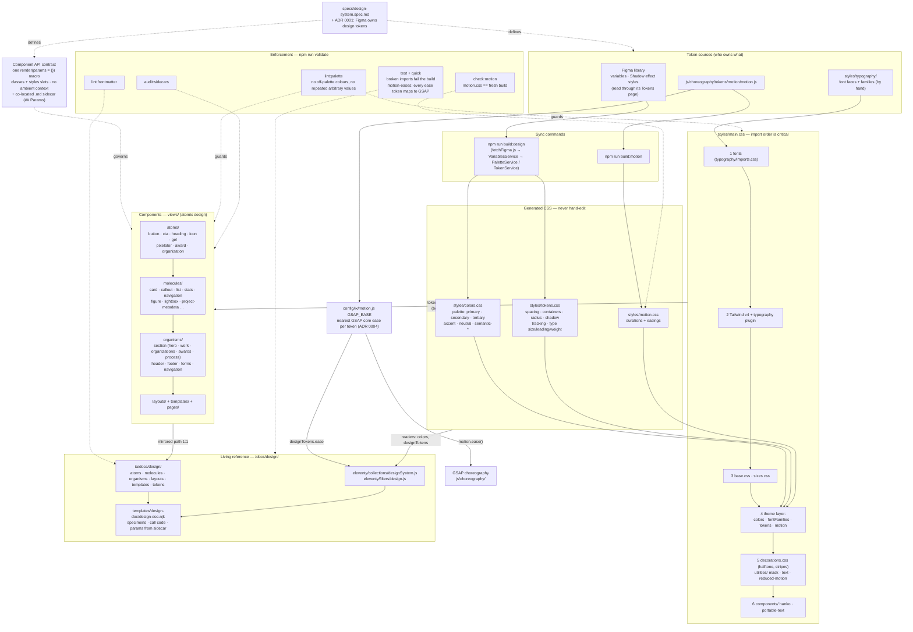

Decision records for the design system and its token pipeline. Each ADR says what was decided, why, and what it changed. The [design system spec](../design-system.spec.md) states the rules that follow from them.

# Decisions

## What's here

- [adr-0001-figma-owns-design-tokens.md](adr-0001-figma-owns-design-tokens.md): accepted; who owns which tokens, and why
- [adr-0002-figma-library-variables-are-the-design-tokens.md](adr-0002-figma-library-variables-are-the-design-tokens.md): proposed; moves the token source from the old Figma file to the design-system library's variables
- [adr-0003-figma-owns-mapped-component-colours.md](adr-0003-figma-owns-mapped-component-colours.md): proposed; extends Figma ownership from tokens to a mapped component's colour utilities, starting with Button
- [adr-0004-gsap-runs-motion-eases-as-mapped-core-eases.md](adr-0004-gsap-runs-motion-eases-as-mapped-core-eases.md): accepted; GSAP runs each motion-token ease as the nearest GSAP core ease, through `GSAP_EASE`

## Token ownership

Where each token comes from, how it reaches the CSS, and what guards it.

## See also

- [Design system spec](../design-system.spec.md)
- [Component API spec](../views/component-api.views-spec.md)
- [Figma sync](../../figma/README.md)
- [Motion tokens](../../js/choreography/tokens/motion/motion.md)
- [Design system inventory](../../reports/design-system/inventory.md)
