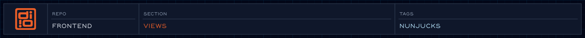

<!-- readme-header: generated by `npm run build:readme`, edit the script, not this block -->

<!-- /readme-header -->

Nunjucks templates that build every page of the site, organized small-to-large.

<!-- @format -->

# Views

The Nunjucks templates behind every page, organized by size: small pieces build up into whole pages.

## What's here

- `atoms/` - smallest pieces: button, icon, heading, link, video
- `molecules/` - atoms combined: cards, forms, lists, lightbox, pager
- `organisms/` - page sections: header, footer, navigation, homepage sections
- `layouts/` - page shells: they own `<html>`, define the blocks and hold the `<head>` partials
- `templates/` - page types: one folder each (home, project, projects, post, posts, contact, article, design-doc)

## Two tiers, one rule

Content in `ia/` picks a template with `layout:`. A template extends a layout. Nothing else is a `layout:` target.

- A layout (shell) owns `<html>`, defines blocks and carries no CMS content.
- A template is a page type. It is selected by an `ia/` page's `layout:`, and fills the blocks of a shell.
- The real pages are `ia/*.md` plus Sanity; `templates/` holds no pages of its own.

## How it connects

- Eleventy treats `views/` as its includes folder, so paths like `atoms/button.njk` work from any template.
- Components get their data from the page that includes them; see `data/` for where that comes from.
- Each `.njk` file has a `.md` note beside it describing its parameters.
- Every atom, molecule, and organism renders live in the design-system reference at `/docs/design/` (`ia/docs/design/`).

## See also

- [Component API](../specs/views/component-api.views-spec.md)
- [User guide](../specs/views/user-guide.views-spec.md)
- [Homepage spec](../specs/views/home.views-spec.md)

<!-- readme-index:start -->
## Index

- [atoms/](atoms/README.md)
- [layouts/](layouts/README.md)
- [molecules/](molecules/README.md)
- [organisms/](organisms/README.md)
- [templates/](templates/README.md)
<!-- readme-index:end -->
