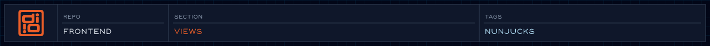

<!-- @format -->

<!-- readme-header: generated by `npm run build:readme`, edit the script, not this block -->

<!-- /readme-header -->

# Views

The Nunjucks templates behind every page, organized by size: small pieces build up into whole pages.

## What's here

- `atoms/` - smallest pieces: button, icon, heading, link, video
- `molecules/` - atoms combined: cards, forms, lists, lightbox, pager
- `organisms/` - page sections: header, footer, navigation, homepage sections
- `templates/` - page bodies (article, blog, case study, landing) and `<head>` partials
- `layouts/` - base page shells that pages extend
- `pages/` - the page entry points (home, project, projects, contact)
- `_registry/` - a single file that imports common components

## How it connects

- Eleventy treats `views/` as its includes folder, so paths like `atoms/button.njk` work from any template.
- Components get their data from the page that includes them; see `data/` for where that comes from.
- Each `.njk` file has a `.md` note beside it describing its parameters.

## See also

- [Component API](../specs/views/component-api.views-spec.md)
- [User guide](../specs/views/user-guide.views-spec.md)
- [Homepage spec](../specs/views/home.views-spec.md)
