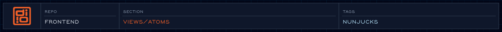

<!-- @format -->

<!-- readme-header: generated by `npm run build:readme`, edit the script, not this block -->

<!-- /readme-header -->

# Atoms

The smallest building blocks. Everything else is built from these.

## What's here

- `button.njk`, `cta.njk` - buttons and calls to action
- `heading.njk`, `icon.njk` - headings and icons
- `link/` - links and nav links
- `award.njk`, `organization.njk` - small award and organization badges
- `gel.njk`, `pixelator.njk`, `hanko/` - decorative effects
- `printmarks/`, `svg/`, `video/` - print marks, inline SVG, video

## How it connects

- Used by molecules, organisms and templates.
- Atoms take plain parameters and avoid depending on other components.

## See also

- [Component API](../../specs/views/component-api.views-spec.md)
- [Molecules](../molecules/README.md)
