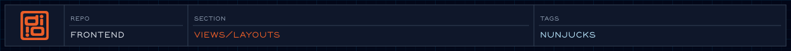

<!-- readme-header: generated by `npm run build:readme`, edit the script, not this block -->

<!-- /readme-header -->

# Layouts

Base page shells. Pages pick one with ``.

## What's here

- `base.njk` - the default shell
- `cols-2-before.njk`, `cols-2-after.njk`, `cols-3.njk` - column layouts
- `storyboards.njk` - storyboard pages
- `.canvas` files - inheritance diagrams for Obsidian

## How it connects

- Extended by pages and templates.
- Fill in the shell with the blocks it defines.

## See also

- [Templates](../templates/README.md)
