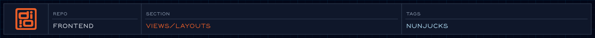

<!-- readme-header: generated by `npm run build:readme`, edit the script, not this block -->

<!-- /readme-header -->

Page shells that own `<html>` and define blocks.

# Layouts

Page shells. A shell owns `<html>`, defines the blocks and carries no CMS content. Templates pick one with ``.

## What's here

- `base.njk` - the default shell
- `landing.njk` - the shell for the landing-style pages
- `cols-2-before.njk`, `cols-3.njk` - column layouts
- `partials/` - head, fonts, favicon, manifest, analytics, scripts
- `.canvas` files - inheritance diagrams for Obsidian

## How it connects

- Extended by the page types in `templates/`.
- `partials/head/` is included by the base layout.
- Fill in the shell with the blocks it defines.

## See also

- [Templates](../templates/README.md)

<!-- readme-index:start -->
## Index

- [base.canvas](base.canvas)
- [base.md](base.md)
- [base.njk](base.njk)
- [cols-2-before.canvas](cols-2-before.canvas)
- [cols-2-before.md](cols-2-before.md)
- [cols-2-before.njk](cols-2-before.njk)
- [cols-3.canvas](cols-3.canvas)
- [cols-3.md](cols-3.md)
- [cols-3.njk](cols-3.njk)
- [landing.canvas](landing.canvas)
- [landing.md](landing.md)
- [landing.njk](landing.njk)
- [Page Build Flow.canvas](Page%20Build%20Flow.canvas)
- [partials/](partials/)
<!-- readme-index:end -->
