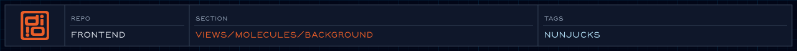

<!-- readme-header: generated by `npm run build:readme`, edit the script, not this block -->

<!-- /readme-header -->

# Background

The container for the page's background video.

## What's here

- `sizzle-background.njk` - the template
- `sizzle-background-flow.canvas` - a flow diagram of how it works

## How it connects

- Included on the homepage.
- Scroll behavior comes from `js/choreography/organisms/background/BackgroundVideo.js`.

## See also

- [Molecules](../README.molecules.md)
- [Choreography](../../../js/choreography/README.choreography.md)
