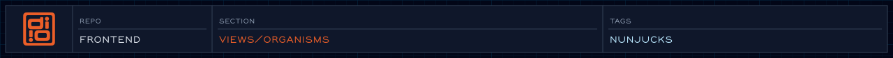

<!-- @format -->

<!-- readme-header: generated by `npm run build:readme`, edit the script, not this block -->

<!-- /readme-header -->

# Organisms

Whole sections of a page, assembled from molecules and atoms.

## What's here

- `header/` - global header, plus article and project headers
- `footer/` - global footer
- `navigation/` - primary nav, breadcrumbs, page nav, skip links
- `section/` - the homepage sections ([details](section/README.md))
- `forms/` - the contact form
- `status/` - the preloader

## How it connects

- Built from molecules and atoms; some organisms include other organisms.
- Included by templates and pages, which pass in the data.

## See also

- [Molecules](../molecules/README.md)
- [Templates](../templates/README.md)

<!-- readme-index:start -->
## Index

- [footer/](footer/)
- [forms/](forms/)
- [header/](header/)
- [navigation/](navigation/)
- [section/](section/README.md)
- [status/](status/)
<!-- readme-index:end -->
