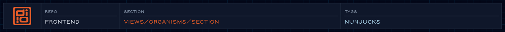

<!-- readme-header: generated by `npm run build:readme`, edit the script, not this block -->

<!-- /readme-header -->

# Section

The homepage sections. Most are one-offs written for the homepage.

## What's here

- `hero.njk` - opening section
- `work.njk` - selected projects
- `organizations.njk` - organizations worked with
- `awards.njk` - awards
- `process.njk` - not currently rendered on any page

## How it connects

- Included by `pages/home/home.njk`, in the order hero, work, organizations, awards.
- Animated by the choreography code in `js/choreography/`.
- Sections with a visible heading link it with `aria-labelledby`.

## See also

- [Homepage spec](../../../specs/views/home.views-spec.md)
- [Choreography](../../../js/choreography/README.md)

<!-- readme-index:start -->
## Index

- [awards.md](awards.md)
- [awards.njk](awards.njk)
- [hero.md](hero.md)
- [hero.njk](hero.njk)
- [organizations.md](organizations.md)
- [organizations.njk](organizations.njk)
- [process.md](process.md)
- [process.njk](process.njk)
- [work.md](work.md)
- [work.njk](work.njk)
<!-- readme-index:end -->
