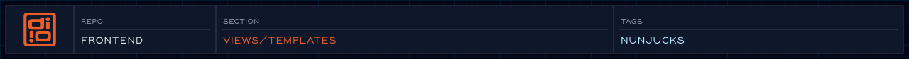

<!-- readme-header: generated by `npm run build:readme`, edit the script, not this block -->

<!-- /readme-header -->

Page types, one folder each, selected by an `ia/` page's `layout:`.

<!-- @format -->

# Templates

Page types, one folder each. An `ia/` page selects one with `layout:`.

## What's here

- `home/`, `project/`, `projects/`, `post/`, `posts/`, `contact/` - the site's page types
- `article/` - article page, used by `/about` and `/user-guide`
- `design-doc/` - the design and choreography reference pages under `/docs/design/`

## How it connects

- Each template extends a shell in `layouts/`, then uses organisms and molecules.
- The pages themselves are `ia/*.md` plus Sanity; `ia/` frontmatter names the template.

## See also

- [Layouts](../layouts/README.md)
- [Organisms](../organisms/README.md)

<!-- readme-index:start -->
## Index

- [article/](article/)
- [contact/](contact/)
- [design-doc/](design-doc/)
- [home/](home/)
- [post/](post/)
- [posts/](posts/)
- [project/](project/)
- [projects/](projects/)
<!-- readme-index:end -->
