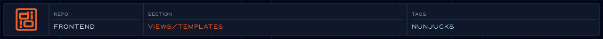

<!-- @format -->

<!-- readme-header: generated by `npm run build:readme`, edit the script, not this block -->

<!-- /readme-header -->

# Templates

Page bodies built from organisms and molecules, plus the pieces that go in `<head>`.

## What's here

- `article.njk` - article page
- `blog/blog.njk` - blog post
- `blog/case-study/case-study.njk` - case study
- `landing/landing.njk` - landing page
- `partials/` - head, fonts, favicon, manifest, analytics, scripts

## How it connects

- Pages in `pages/` use these templates; they in turn use organisms and molecules.
- `partials/head/` is included by the base layout.

## See also

- [Layouts](../layouts/README.md)
- [Organisms](../organisms/README.md)

<!-- readme-index:start -->
## Index

- [blog/](blog/)
- [landing/](landing/)
- [partials/](partials/)
- [article.md](article.md)
- [article.njk](article.njk)
<!-- readme-index:end -->
